<table border="0" cellpadding="0" cellspacing="0">
<tr>
<td width="320" valign="top">

 

<h3>Rohit Maruri 👋</h3>

<strong>Full-Stack AI Engineer</strong> · Founder, <a href="https://github.com/Rohit-ATS/Vivedly-AI">Vivedly Labs Inc.</a>

I build AI systems and agent infrastructure that connect models to real-world data — accessibility tools, research pipelines, and products people actually trust.

📍 San Francisco Bay Area &nbsp;·&nbsp; 🎓 CS @ SFBU (GPA 4.0) 
✉️ <a href="mailto:rohitmaruriats@gmail.com">rohitmaruriats@gmail.com</a>

<strong>Highlights</strong> 
🏆 Finalist — Stanford-Berkeley Big Game Day 
🥈 2nd Place — Flower Labs @ Stanford 
🛰️ Built for NASA Space Apps 2026 
🔬 Undergraduate Student Researcher 
📦 8+ repos shipped this year

 

</td>
<td width="20"></td>
<td valign="top">

<picture>
  <source media="(prefers-color-scheme: dark)" srcset="https://raw.githubusercontent.com/Rohit-ATS/Rohit-ATS/output/stats-strip-dark.svg">
  
</picture>

<strong>Contribution Activity</strong>

<strong>Tech Stack</strong>

<picture>
  <source media="(prefers-color-scheme: dark)" srcset="https://raw.githubusercontent.com/Rohit-ATS/Rohit-ATS/main/assets/typing-dark.svg">
  
</picture>

</td>
</tr>
</table>

  
  
  
  
  

## Featured projects

Projects from my resume, focused on applied AI, real-world workflows, and collaborative systems.

<table>
  <tr>
    <td width="50%" valign="top">
      <h3>🦯 GuideEye</h3>
      
Accessibility app combining obstacle-aware navigation, real-time object detection, and Google Maps data to support visually impaired travelers.

      
<strong>5,000+ route scenarios</strong> analyzed · Sign-language translation at <strong>97% accuracy</strong> · Split mobile/cloud processing under <strong>2,000 ms</strong>

      🏆 Finalist · Stanford-UC Berkeley Big Game Day Hackathon
    </td>
    <td width="50%" valign="top">
      <h3>🔥 FireWatch</h3>
      
Wildfire response platform that brings together live camera imagery, NASA FIRMS hotspots, and weather data for a three-signal view of incidents.

      
<strong>Federated learning</strong> across three stations with Flower FedAvg · Human-approved dispatch · Three incident review and status endpoints

      🥈 2nd place · Flower Labs Collaborative Agent Hackathon at Stanford
    </td>
  </tr>
  <tr>
    <td width="50%" valign="top">
      <h3>🚀 Crimson Exodus</h3>
      
Multiplayer Mars survival game using NASA satellite and rover data for terrain analysis and AI-assistant training.

      
<strong>5 datasets</strong> · <strong>15+</strong> environmental and survival constraints · Real-time multiplayer for <strong>50+</strong> simultaneous sessions

      🛰️ Built for NASA Space Apps 2026 ·
      
      
    </td>
    <td width="50%" valign="top">
      <h3>🤖 Mesa AI</h3>
      
Agentic workflow built for a real business to automate administrative processes and return time to the team.

      
Automated <strong>80%</strong> of administrative work · Saved <strong>20+ hours per week</strong> · <strong>97% workflow success rate</strong>

      🏅 Stanford 30×30 Business Hackathon ·
      
      
    </td>
  </tr>
  <tr>
    <td width="50%" valign="top">
      <h3>💼 Relay CRM</h3>
      
AI-native CRM built in a one-day hackathon sprint: CSV import → account/contact/deal records → AI-drafted outreach → human approval → simulated reply → auto-updated records.

      
Next.js App Router · TypeScript · Zod-validated AI JSON · dark, Attio-style UI

      ⚡ Built in a single day ·
      
      
    </td>
    <td width="50%" valign="top">
      <h3>🔒 Airlock</h3>
      
Proves an irreversible production change — schema migrations, data ops, right-to-erasure — on a shadow copy before anyone approves it.

      
TypeScript · Next.js 15 · Postgres shadow branches · MCP server · hash-chain ledger

      ✅ 201 tests / 24 suites ·
      
      
    </td>
  </tr>
</table>

## Selected engineering work

<picture>
  <source media="(prefers-color-scheme: dark)" srcset="https://raw.githubusercontent.com/Rohit-ATS/Rohit-ATS/main/assets/projects-dark.svg">
  
</picture>

[LexisGuide](https://github.com/k1lst1x/LexisGuide) · [DOCKET](https://github.com/k1lst1x/DOCKET) · [FORGE](https://github.com/k1lst1x/FORGE) · [Airlock](https://github.com/Rohit-ATS/Airlock) · [Semantic Output Cache](https://github.com/Rohit-ATS/semantic-output-cache) — every repository is public, MIT, and has its tests in it.

## Hackathons

A regular hackathon competitor — recent builds span agent safety gating, supply-chain security, self-healing scrapers, voice-driven payroll, and graph-based incident response.

| Event | Build | Focus |
|---|---|---|
| Zero Downtime Hackathon | **FORGE** | Agent that builds software from a brief, then audits and self-repairs what it ships |
| Hack Hydra · HydraDB OSS Hackathon | **Blast Radius** | npm supply-chain incident response over 36K+ packages, solo build |
| Agent Harness Hackathon (WeMakeDevs × TrueFoundry) | **AIRLOCK** | Irreversible production changes behind sandbox-proven rollback certificates |
| Into the Scrape-Verse | **SYMBIOTE** | Self-healing data plane for scrapers, tracking AI pricing/model deprecation |
| Collaborative Agent Hackathon @ Stanford (Flower Labs) | **FireWatch** | Federated wildfire detection — 🥈 2nd place |
| Graph Hacks: Context for AI Agents (FalkorDB) | **BLACKBOX** | On-call incident agent over a graph database |
| Monad Metropolis | **Remi** | Voice-driven cross-border payroll for US small businesses |
| 30×30 Real Business AI Buildathon @ Stanford | **Mesa AI** | Agentic automation for a real small business |
| AssemblyAI Dictation Hackathon | — | Real-time dictation on AssemblyAI's beta API |
| AWS Agents for Humans (Devpost) | — | Agent built on the Strands Agents SDK |

## Research & experience

**Undergraduate Student Researcher · San Francisco Bay University**
Working with machine-learning models, vision-language models, and large language models. Current research includes image-based prediction, evaluation workflows over five large datasets, AWS Trainium/Neuron, and multi-agent drone-swarm simulation. Recent experiments measured **92% model accuracy** and **sub-5,000 ms VLM latency**.

**Information Technology Assistant · The Clarion**
Rebuilt the publication's online reading experience, supporting growth from **500 to 3,000 monthly readers**. Also improved customer-support intake and email routing, publishing pipelines, access controls, and day-to-day IT operations.

**IT Assistant · Dominion Academy of Dayton**
Supported more than **60 devices**, resolved **500+ support tickets**, and helped manage access for **160 accounts**.

## Toolkit

| Area | Tools and focus |
|---|---|
| **Languages** | Python · C++ · TypeScript · JavaScript · SQL |
| **AI & agents** | LLM systems · vision-language models · AWS Bedrock AgentCore · embeddings · semantic retrieval · BM25 · MCP |
| **Data & systems** | PostgreSQL · Aurora DSQL · SQLite · pgvector · graph databases · distributed-system design |
| **Product engineering** | React · Next.js · FastAPI · Node.js · Electron · Docker · GitHub Actions · CodeQL |
| **Cloud & research** | AWS · S3 Vectors · Trainium/Neuron · federated learning · Flower |

## Education

**B.S. Computer Science · San Francisco Bay University** · GPA **4.0**
Student Researcher · ACM · IEEE

## Activity

<picture>
  <source media="(prefers-color-scheme: dark)" srcset="https://raw.githubusercontent.com/Rohit-ATS/Rohit-ATS/output/stats-dark.svg">
  
</picture>

<picture>
  <source media="(prefers-color-scheme: dark)" srcset="https://raw.githubusercontent.com/Rohit-ATS/Rohit-ATS/output/snake-dark.svg">
  
</picture>

> *“Build useful things. Measure what matters. Make the evidence visible.”*

**Open to internships, research collaborations, and building with ambitious teams.**

[Say hello](mailto:rohitmaruriats@gmail.com) · [LinkedIn](https://www.linkedin.com/in/rohitmaruri/)

